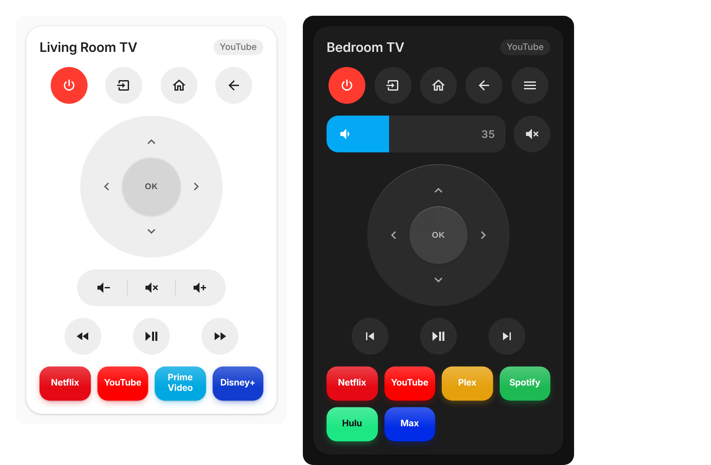
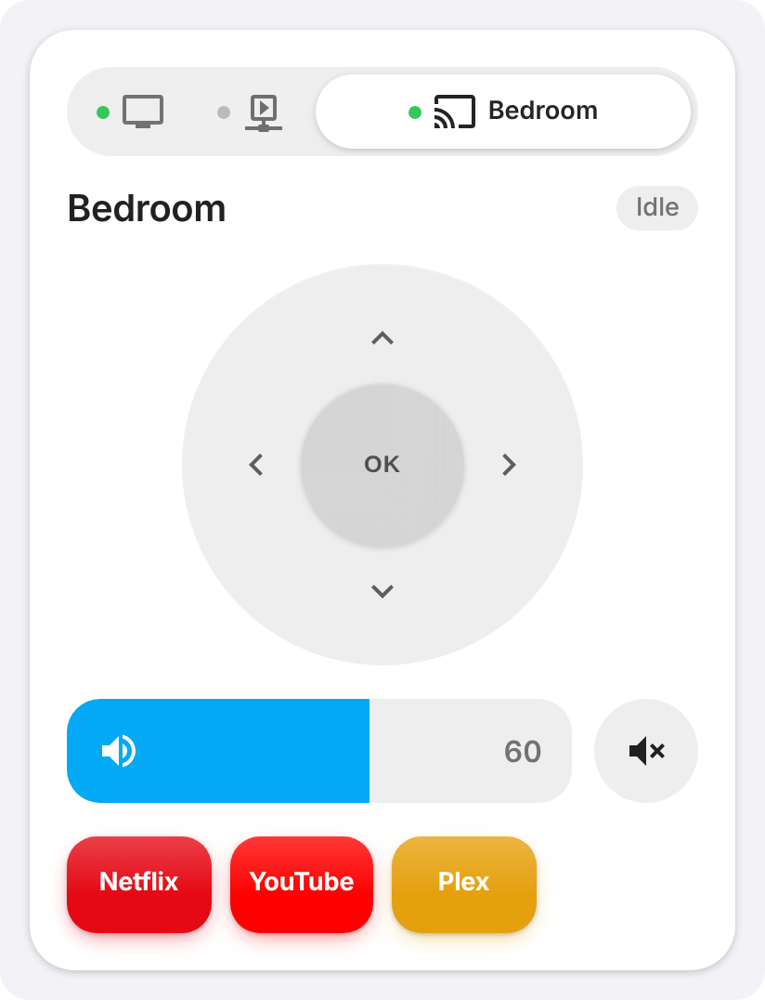

# Google TV Remote Card

[](https://hacs.xyz/docs/faq/custom_repositories)
[](https://github.com/YounesN/google-tv-remote-card/actions/workflows/build.yml)

A Home Assistant dashboard card that turns your **Google TV or Android TV** (TCL, NVIDIA Shield, Google TV Streamer, Chromecast with Google TV, Sony and more) into a clean, iOS-style remote. Pick the rows you want: buttons, an Apple TV–style clickpad, volume as buttons or a slider, media controls, and one-tap app launchers.



- Works with the built-in **Android TV Remote** integration. No extra add-ons or ADB needed.
- Row-based config: choose exactly which buttons and apps appear, and in what order.
- 30 built-in buttons, 15 built-in apps, plus your own buttons (any Android TV key or Home Assistant script) and apps.
- Follows your Home Assistant theme in light and dark mode.

> Works with any device the Android TV Remote integration supports: TVs running **Google TV or Android TV** (TCL, Sony, Philips, Hisense and others), **NVIDIA Shield**, **Google TV Streamer** and **Chromecast with Google TV**. One card can switch between several devices. Roku, webOS and Tizen TVs use different integrations and aren't supported. This project isn't affiliated with Google, TCL or NVIDIA.
>
> Previously called *TCL Remote Card*. Existing `custom:tcl-remote-card` dashboards keep working.

---

## Contents

1. [Pair your TV with Home Assistant](#1-pair-your-tv-with-home-assistant)
2. [Install the card](#2-install-the-card)
3. [Add the card to a dashboard](#3-add-the-card-to-a-dashboard)
4. [Configuration](#configuration)
5. [Troubleshooting](#troubleshooting)

---

## 1. Pair your TV with Home Assistant

The card talks to your TV through Home Assistant's official [Android TV Remote](https://www.home-assistant.io/integrations/androidtv_remote/) integration, which uses the same protocol as the Google TV app on your phone.

### Before you start

- Your TV and Home Assistant must be on the **same network**.
- Turn the TV **on** and keep it on the home screen during pairing.
- Write down the TV's IP address: on the TV, open **Settings → Network & Internet**, select your network, and look for **IP address**. Giving the TV a fixed address (a DHCP reservation in your router) prevents it from dropping out later.

### Pair

1. In Home Assistant, go to **Settings → Devices & services**.
2. Your TV is often discovered automatically and shows up under **Discovered**. Click **Add** on it. If it doesn't appear, click **+ Add integration**, search for **Android TV Remote**, and enter the TV's IP address.
3. A **pairing code** appears on the TV screen (6 characters, letters and numbers).
4. Type the code into Home Assistant and click **Submit**.
5. Pick an area for the TV and finish.

Home Assistant now has two entities for your TV, for example:

| Entity | Used by the card for |
| --- | --- |
| `media_player.living_room_tv` | Power, current app, volume slider |
| `remote.living_room_tv` | Button presses and launching apps |

You only give the card the `media_player`. It finds the matching `remote` automatically.

### Let Home Assistant turn the TV on

When a TV is off it may also turn off its network connection, and then Home Assistant can't wake it. To keep the power button working, enable the TV's network standby option. Its name varies by brand and model. On TCL Google TVs, look under **Settings → System → Power & energy** for something like **Network standby**, **Wake on network**, or **Turn on with Chromecast**.

### Optional: app shortcuts in the integration

Under **Settings → Devices & services → Android TV Remote → Configure**, you can give apps friendly names and icons. This doesn't affect the card. The card has its own app list (see [Apps](#apps)).

---

## 2. Install the card

### HACS (recommended)

1. Open **HACS** in Home Assistant.
2. Click the **⋮** menu in the top right → **Custom repositories**.
3. Add `https://github.com/YounesN/google-tv-remote-card` with type **Dashboard**, then click **Add**.
4. Search for **Google TV Remote Card**, open it, and click **Download**.
5. Reload your browser when prompted.

### Manual

1. Download `google-tv-remote-card.js` from the [latest release](https://github.com/YounesN/google-tv-remote-card/releases/latest).
2. Copy it to `/config/www/google-tv-remote-card.js`.
3. Go to **Settings → Dashboards → ⋮ → Resources → + Add resource**, enter `/local/google-tv-remote-card.js`, and choose **JavaScript module**.
4. Reload your browser.

---

## 3. Add the card to a dashboard

Edit a dashboard, click **+ Add card**, and search for **Google TV Remote Card**. Or add a **Manual** card with:

```yaml
type: custom:google-tv-remote-card
entity: media_player.living_room_tv
```

That gives you the default layout: power / input / home / back, the clickpad, volume buttons, media controls, and Netflix, YouTube, Prime Video and Disney+.

---

## Configuration

| Option | Required | Description |
| --- | --- | --- |
| `entity` | yes\* | The TV's `media_player` entity. |
| `entities` | yes\* | Several devices to switch between. See [Multiple devices](#multiple-devices). |
| `remote_entity` | no | The TV's `remote` entity. Only needed if the card can't find it by itself. |
| `name` | no | Title shown on the card. Defaults to the TV's name. |
| `show_header` | no | Set to `false` to hide the title and current app. |
| `rows` | no | The rows of the remote, top to bottom. See below. Defaults to the layout above. |

\* Set `entity`, `entities`, or both.

### Multiple devices

One card can control several devices. They appear as tabs at the top, and a green dot shows which ones are on. Each browser remembers the last tab you picked.



```yaml
type: custom:google-tv-remote-card
entities:
  - entity: media_player.living_room_tv
    name: Living room
    icon: mdi:television
  - entity: media_player.shield
    name: Shield
    icon: mdi:play-box-outline
  - media_player.bedroom_streamer      # just the entity works too
rows:
  - [power, source, home, back]
  - dpad
  - volume: slider
  - apps: [netflix, youtube, plex]
```

Each device accepts `entity`, `name`, `icon` and `remote_entity`. All devices share the same `rows`. When devices have icons, the tabs that aren't selected shrink to just the icon, so long names never get cut off.

### Rows

Each entry in `rows` is one row of the remote:

| Row | What it shows |
| --- | --- |
| `[power, source, home, back]` | A row with any buttons you list (see [Buttons](#buttons)). |
| `dpad` | The round clickpad: up, down, left, right and OK. |
| `volume: buttons` | Volume down, mute and volume up in one pill. Shorthand: `volume`. |
| `volume: slider` | A volume slider with a mute button. Shorthand: `volume_slider`. |
| `media` | Rewind, play/pause, fast forward. |
| `apps: [netflix, youtube]` | App tiles (see [Apps](#apps)). Shorthand `apps` shows the four defaults. |
| `buttons: [...]` | Same as a plain list. Handy when mixing in custom buttons. |
| `power` (any button name) | That single button on its own row. |

### Example

```yaml
type: custom:google-tv-remote-card
entity: media_player.living_room_tv
name: Living Room
rows:
  - [power, source, home, back, menu]
  - volume: slider
  - dpad
  - [previous, play_pause, next]
  - apps: [netflix, youtube, plex, spotify, hulu, max]
```

### Buttons

| Name | Does | | Name | Does |
| --- | --- | --- | --- | --- |
| `power` | Turn TV on/off | | `volume_up` | Volume up |
| `source` | Input / source menu | | `volume_down` | Volume down |
| `home` | Home screen | | `mute` | Mute |
| `back` | Back | | `channel_up` | Channel up |
| `menu` | Menu | | `channel_down` | Channel down |
| `settings` | Settings | | `play_pause` | Play / pause |
| `info` | Info | | `play` | Play |
| `guide` | Program guide | | `pause` | Pause |
| `search` | Search | | `stop` | Stop |
| `assistant` | Google Assistant | | `rewind` | Rewind |
| `captions` | Subtitles | | `fast_forward` | Fast forward |
| `up` `down` `left` `right` `ok` | Navigation | | `previous` / `next` | Previous / next track |

#### Custom buttons

Send any Android TV key, or call any Home Assistant service:

```yaml
rows:
  - buttons:
      - channel_down
      - icon: mdi:numeric-1
        name: "1"
        command: "1"                 # an Android TV key code
      - icon: mdi:movie-open
        name: Movie mode
        service: script.movie_mode   # any service
        data: {}
      - channel_up
```

`command` is sent with `remote.send_command`, so any key the [Android TV Remote integration](https://www.home-assistant.io/integrations/androidtv_remote/#remote) supports works (for example `PROG_RED`, `DVR`, `KEYCODE_TV`). Icons come from [Material Design Icons](https://pictogrammers.com/library/mdi/).

### Apps

| Name | | Name | | Name |
| --- | --- | --- | --- | --- |
| `netflix` | | `max` | | `spotify` |
| `youtube` | | `apple_tv` | | `twitch` |
| `youtube_music` | | `paramount_plus` | | `crunchyroll` |
| `prime_video` | | `peacock` | | `google_tv` |
| `disney_plus` | | `hulu` | | `plex` |

#### Custom apps

Any installed app can be added by its package name (or a deep link):

```yaml
rows:
  - apps:
      - netflix
      - name: Kodi
        activity: org.xbmc.kodi
        color: "#17b2e7"       # tile color (optional)
        text_color: "#ffffff"  # label color (optional)
        icon: mdi:kodi         # icon before the label (optional)
```

**Finding an app's package name:** open the app on the TV, then in Home Assistant go to **Developer tools → States**, find your `media_player`, and read its `app_id` attribute.

### Styling

The card follows your theme. To fine-tune it, set these CSS variables in your theme (or with [card-mod](https://github.com/thomasloven/lovelace-card-mod)):

| Variable | Default | Effect |
| --- | --- | --- |
| `--gtv-btn-size` | `56px` | Size of round buttons |
| `--gtv-accent` | theme primary color | Volume slider fill |
| `--gtv-red` | `#ff3b30` | Power button color |

---

## Troubleshooting

**No pairing code appears on the TV.** Make sure the TV is on and awake, then try again. Restarting the TV usually helps. On some TVs the *Android TV Remote Service* app needs an update from the Play Store.

**The card says "No remote entity found".** Check that the Android TV Remote integration created a `remote.` entity for the TV, then set it with `remote_entity:`.

**Buttons work but the power button can't turn the TV on.** Enable network standby on the TV (see [Let Home Assistant turn the TV on](#let-home-assistant-turn-the-tv-on)).

**An app tile does nothing.** The built-in package name may differ in your region. Open the app on the TV, read `app_id` as described in [Custom apps](#custom-apps), and add it as a custom app.

**The TV became unavailable after a router change.** Its IP address probably changed. Give it a fixed address in your router. If it still doesn't reconnect, delete the integration entry and pair again.

**The card doesn't show up after installing.** Clear your browser cache or reload with the cache disabled. In the Home Assistant mobile app, use **Settings → Companion app → Debugging → Reset frontend cache**.

---

## Development

```bash
npm install
npm run build      # outputs dist/google-tv-remote-card.js
npm run watch      # rebuild on change
npm run typecheck
```

## License

[MIT](LICENSE)
